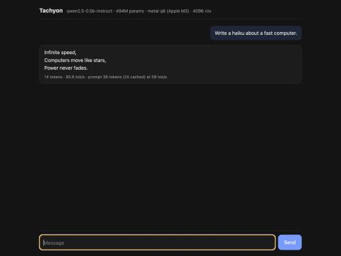

# Tachyon

[](https://github.com/divyanshkhurana06/Tachyon/actions/workflows/ci.yml)

**An LLM inference engine and serving stack written from scratch in Rust, with hand-written ARM NEON and Metal GPU kernels, and zero dependencies.**

Tachyon runs real Hugging Face checkpoints (Llama 3.2, Qwen2.5, Qwen3, and IBM's Granite mixture of experts) on a MacBook's CPU or GPU, on x86 with AVX2, or in a browser tab compiled to WebAssembly, and serves many users at once the way vLLM does: a paged KV cache with prefix sharing, continuous batching with priorities and swap-out preemption, many LoRA fine-tunes served from one base model, and an OpenAI-compatible API. It quantizes to 8 and 4 bits (with activation-aware calibration), decodes speculatively (with a draft model or with no model at all), and supports the API features agents rely on: structured output that matches a JSON Schema (patterns and ranges included), tool calling in each model's own format, and logprobs. Everything between the weights file and the HTTP response is in this repository, including the JSON parser, safetensors reader, BPE tokenizer, thread pool, SIMD kernels, GPU shaders, scheduler and web server. `Cargo.toml` has no dependencies.



## Results

All on a MacBook Air M3 (8-core CPU, 10-core GPU, 16 GB), with other apps running.

### Serving many users: 9.8x the throughput of one

`tachyon serve --gpu` with Qwen2.5-0.5B (8-bit), driven by `tachyon loadtest`: each client streams 128-token replies back to back.

| concurrent users | total throughput | per user | mean batch | time to first token (p50) |
|---:|---:|---:|---:|---:|
| 1 | 103 tok/s | 105 tok/s | 1.0 | 0.02 s |
| 4 | 246 tok/s | 61 tok/s | 4.0 | 0.03 s |
| 16 | 768 tok/s | 49 tok/s | 15.9 | 0.07 s |
| 32 | **1,014 tok/s** | 32 tok/s | 31.9 | 0.09 s |

Decoding one sequence reads every weight once per token, so it is limited by memory bandwidth. Batching N sequences shares that read N ways, and the GPU's matrix units do the extra arithmetic almost for free. The engine alone, one token per sequence per step:

| batch | GPU step time | GPU throughput | CPU throughput |
|---:|---:|---:|---:|
| 1 | 7.6 ms | 132 tok/s | 150 tok/s |
| 4 | 13.6 ms | 294 tok/s | 404 tok/s |
| 8 | 14.9 ms | 536 tok/s | 477 tok/s |
| 16 | 20.3 ms | 790 tok/s | 502 tok/s |
| 32 | 27.6 ms | 1,157 tok/s | 494 tok/s |
| 64 | 48.3 ms | 1,324 tok/s | 458 tok/s |

The CPU gets 3.3x by batch 16, with sequences sharing each weight load in its int8 matrix instructions, and is then limited by arithmetic, not memory, so extra sequences just take turns. From `tachyon bench-batch`, 8-bit weights.

95% of the server's step time is the forward pass; sampling, streaming and scheduling are the other 5%.

### Many fine-tunes from one model: multi-LoRA serving

`tachyon serve --lora support=adapters/support --lora sql=adapters/sql` loads LoRA adapters (PEFT's format) beside the base model, and a request picks one by naming it as its `model`, as with vLLM. Requests for different adapters, and for none, share every forward pass: each token's update `B (A x)` is added beside the base matmul, with the batch's tokens grouped by adapter so each adapter's weights are read once per step (Punica's SGMV). Throughput with four rank-16 adapters on every projection (q, k, v, o, gate, up, down: 1.8% of the model's parameters each, the heavy end), every step mixing all four, against the base model alone:

| batch | GPU, base | GPU, 4 adapters mixed | | CPU, base | CPU, 4 adapters mixed | |
|---:|---:|---:|---:|---:|---:|---:|
| 1 | 137 tok/s | 124 tok/s | 90% | 147 tok/s | 135 tok/s | 92% |
| 4 | 219 tok/s | 202 tok/s | 92% | 439 tok/s | 337 tok/s | 77% |
| 16 | 776 tok/s | 709 tok/s | 91% | 625 tok/s | 462 tok/s | 74% |
| 64 | 1,690 tok/s | 1,502 tok/s | 89% | 540 tok/s | 440 tok/s | 81% |

From `tachyon bench-batch --lora ...` (8-bit base). A test checks the adapters against the same updates merged into the weights, and the GPU's against the CPU's (to 0.0001 in logits).

**Adapters come and go while serving.** With `--allow-lora-loading`, `POST /v1/load_lora_adapter` with `{"lora_name": "sql", "lora_path": "adapters/sql"}` loads one into a running server and `POST /v1/unload_lora_adapter` with `{"lora_name": "sql"}` removes it (vLLM's endpoints; off by default, since they read whatever path they are given). Loads, unloads and requests go through the scheduler's one queue, so a request runs with the adapter it named or is refused, never with one swapped in under it; an adapter some request is still using can't be unloaded. Each adapter ever loaded gets its own prefix-cache salt, so one loaded into a freed id never picks up the previous adapter's cached prompts (a test catches exactly that when the salt is the id).

### Under memory pressure: swap-out preemption and priorities

When the KV cache fills, the least urgent sequence (by `priority`, then arrival) is preempted. With swap space (`--swap-tokens`, on by default) its keys and values are copied out to host memory and back in when it resumes; blocks still in the prefix cache are taken from there rather than copied. With 32 users in a 2,048-token cache (about 150 preemptions per run), swapping matched recomputing in throughput (953 against 951–953 tok/s): the prefix cache already keeps most of a preempted sequence's work. It lowered the median time to first token to 0.09–0.10 s, from 0.10–0.18 s.

A more urgent request that finds no room **preempts** less urgent running ones (strictly less: equals never preempt each other) instead of waiting for one to finish. With 16 load-test clients keeping an 8-sequence server full of 128-token replies, an urgent request (`"priority": -1`) waited a median 9.3 s for its first token, until a wave of replies finished; now it takes 0.034 s, at the cost of one swapped-out reply per urgent request. Tests check that preempted requests, swapped or recomputed, produce exactly the text they produce alone, and that an urgent request preempts the running one while the rest start in priority order.

### Single-sequence speed and quality

Qwen2.5-0.5B-Instruct, one sequence at a time:

| backend | format | weights | prefill | decode | perplexity |
|---|---|---:|---:|---:|---:|
| GPU | bf16 | 988 MB | 2,621 tok/s | 83.0 tok/s | 17.95 |
| GPU | 8-bit | 525 MB | 2,632 tok/s | 141.8 tok/s | 17.99 |
| GPU | `q4m` (mixed 4/8-bit) | 417 MB | 2,488 tok/s | 147.9 tok/s | 18.69 |
| GPU | `q4` (mostly 4-bit) | 366 MB | 2,452 tok/s | **148.7 tok/s** | 19.42 |
| CPU | bf16 | 988 MB | 168 tok/s | 82.3 tok/s | 17.94 |
| CPU | 8-bit | 525 MB | 689 tok/s | 137.4 tok/s | 18.05 |
| CPU | `q4m` | 417 MB | 590 tok/s | 139.4 tok/s | 18.66 |
| CPU | `q4` | 366 MB | 553 tok/s | 141.1 tok/s | 19.42 |

From `tachyon bench`: best of 3 runs, prefill 256 tokens, decode 128, perplexity over 979 tokens of [`bench/eval.txt`](bench/eval.txt). Speeds move by ±20% with background load, CPU decode most of all.

- **Decode** is one token at a time, which is how chat replies are generated. Smaller weights mean fewer bytes per token, so faster decoding.
- **Prefill** is processing the prompt. The GPU does it on its matrix units (`simdgroup_matrix`), for the matrix multiplies and for attention; the CPU with ARM's int8 matrix instructions (I8MM), two weight rows by two tokens per instruction.
- **Perplexity** measures how surprised the model is by a held-out text (lower is better). CPU and GPU agree in bf16 (to 0.002) because they compute the same function. `q4` and `q4m` are mixed precision: the matrices that measurably matter most stay at 8 bits (see below).

**Quality, measured by KL divergence.** Perplexity over 979 tokens is too noisy to rank formats: nudging every 8-bit scale by one f16 step moves it by 0.03, about the size of the differences being measured. `tachyon kld` runs bf16 and a format side by side over the text and compares their whole next-token distributions at every position (the KL divergence, which llama.cpp also reports for its quant types), along with how often their most likely tokens agree. On the GPU:

| format | weights | bits per weight (whole model) | KL divergence from bf16 | top token agrees | perplexity |
|---|---:|---:|---:|---:|---:|
| 8-bit | 525 MB | 8.50 | 0.0008 | 98.1% | 17.99 |
| `q4m` | 417 MB | 6.75 | 0.0359 | 87.9% | 18.69 |
| `q4m` + importance matrix | 417 MB | 6.75 | **0.0210** | 90.7% | 18.63 |
| `q4` | 366 MB | 5.93 | 0.0714 | 84.4% | 19.42 |
| `q4` + importance matrix | 366 MB | 5.93 | **0.0310** | 88.5% | 18.99 |

4-bit blocks store a **scale and an offset** each (`value = scale * (q - 8) + offset`), fitted together by weighted least squares over several roundings, so a block's 16 levels span its own range rather than one centred on zero (that took `q4m`'s perplexity loss against bf16 from 7.7% to 3.2%). As two f32s per 32 weights they cost 2 bits per weight. Now they are **packed**: every 8 blocks of a row (256 weights) share an f16 step for scales and one for offsets, and each block keeps an 8-bit multiple of each, refitted to that grid (4.625 bits per weight for the 4-bit matrices, from 6; llama.cpp's Q4_K spends 4.5 on 6-bit fields, which cost too much to unpack, below). 8-bit blocks keep an f16 scale instead of an f32 (8.5 bits, from 9). Against the f32 layout, models are 6-18% smaller with the same quality (KL divergence 0.0359 against 0.0361 for `q4m`, 0.0714 against 0.0725 for `q4`, and the same with the importance matrix), and 4-bit decoding is 13-26% faster on the GPU and as fast as before on the CPU. Qwen2.5-1.5B's `q4` went from 1,278 MB and 45.7 tok/s on the GPU to 1,048 MB and 57.5 tok/s.

The **importance matrix** (`tachyon calibrate`, then `--imatrix`) runs calibration text through the model, records how large each linear layer's inputs are per channel, and weights each 4-bit block's fit by those activations (llama.cpp's imatrix, in the spirit of AWQ). It cuts KL divergence from bf16 by 40% for `q4m` and 57% for `q4`. By perplexity it had looked like no help to `q4m` (18.65 against 18.52 without it), which is what the noisy measure got wrong. The calibration text ([`bench/calib.txt`](bench/calib.txt)) is separate from the evaluation text.

Qwen3-0.6B on the GPU: 65 tok/s in bf16, 110 tok/s in 8-bit.

**Llama 3.2 1B Instruct** (Llama 3's scaled RoPE, tokenizer and chat format): on the GPU in 8-bit, 1,156 tok/s prefill and 61 tok/s decode; perplexity 16.64 in 8-bit against 16.66 in bf16, where CPU and GPU agree exactly.

**Granite 3.1 1B-A400M Instruct**, IBM's mixture of experts (32 experts per layer, 8 per token, so 400M of its 1.3B parameters work on each token):

| backend | format | weights | prefill | decode | perplexity |
|---|---|---:|---:|---:|---:|
| GPU | bf16 | 2,669 MB | 1,714 tok/s | 81.3 tok/s | 10.63 |
| GPU | 8-bit | 1,419 MB | 1,770 tok/s | 138.2 tok/s | 10.62 |
| GPU | `q4m` | 1,016 MB | 1,688 tok/s | 145.1 tok/s | 10.89 |
| CPU | 8-bit | 1,419 MB | 584 tok/s | 118.5 tok/s | 10.67 |
| CPU | `q4m` | 1,016 MB | 480 tok/s | 127.7 tok/s | 10.90 |

(Perplexities of different models aren't comparable: they tokenize the text differently.)

**In the browser**: the same engine compiled to WebAssembly with SIMD kernels chats with Qwen2.5-0.5B in 8-bit at **49 tok/s** on one thread, in a Chrome tab on the same Mac, after converting the 1 GB checkpoint in 2.7 s.

### Against llama.cpp

Same model (Qwen2.5-0.5B-Instruct, 8-bit: Tachyon's `q8` against Qwen's official Q8_0 GGUF, the same layout of int8 values and an f16 scale per 32), same MacBook Air M3, llama.cpp build b12040 with its Metal backend, runs alternated between the two engines. llama.cpp numbers are from `llama-bench`; decode is measured after the given amount of context (`-d`, and `tachyon bench --context`).

| | llama.cpp | Tachyon | Tachyon vs llama.cpp |
|---|---:|---:|---:|
| GPU prefill, 256 tokens | 2,358–3,039 tok/s | 2,946 tok/s | **on par** |
| GPU prefill, 2,048 tokens | 3,043 tok/s | 2,752 tok/s | 90% |
| GPU decode, 256-token context | 131–138 tok/s | 138 tok/s | **on par** |
| GPU decode, 2,048-token context | 128–129 tok/s | 113–125 tok/s | ~92% |
| CPU prefill, 6 threads | 976–986 tok/s | 606–614 tok/s | ~62% |
| CPU decode, 6 threads | 134–140 tok/s | 125–129 tok/s | ~92% |

Short prompts and chat-length decoding are on par with llama.cpp, a mature engine with years of Apple-specific tuning, from code with no dependencies, and long prompts are at 90%. The remaining gap is CPU prefill, which llama.cpp sends through Apple's Accelerate framework to the AMX matrix units while Tachyon uses ARM's int8 matrix instructions. Over the last four releases GPU prefill went from 64% to on par, and from 63% to 90% for 2,048-token prompts (attention compiled for the model's head size, below); CPU prefill from 20% to about 65%; and GPU decode from 93% to on par (with the packed scales below).

### Speculative decoding: up to 2.2x faster

A drafter guesses several tokens; the big model checks them all in one batched pass and keeps the ones it agrees with. Greedy runs produce output **token-for-token identical** to plain decoding; sampled runs keep the target's exact output distribution (the rejection-sampling rule, checked by a statistical test). On the GPU:

| target | drafter | sampling | drafts accepted | tokens per pass | speedup |
|---|---|---|---:|---:|---:|
| Qwen2.5-1.5B bf16 | 0.5B in 4-bit, 6 per step | greedy, code prompt | 80% | 5.6 | **2.19x** |
| Qwen2.5-1.5B bf16 | 0.5B in 4-bit, 4 per step | greedy, code prompt | 81% | 4.2 | **1.89x** |
| Qwen2.5-1.5B bf16 | 0.5B in 4-bit, 5 per step | temperature 0.7 | 73% | 4.6 | **1.89x** |
| Qwen2.5-1.5B bf16 | 0.5B in 4-bit, 4 per step | greedy, a short story | 39% | 2.5 | 1.26x |
| Qwen2.5-1.5B bf16 | **prompt lookup** (no model) | greedy, editing code | 23% | 2.0 | **1.83x** |
| Qwen2.5-0.5B bf16 | **prompt lookup** (no model) | greedy, editing code | 30% | 2.2 | **1.75x** |

Prompt lookup drafts by finding the last few tokens earlier in the context and proposing what followed them, which is ideal when the reply copies from the prompt (edits, summaries, answering over a document). On the CPU, speculation doesn't pay: checking 5 tokens costs 5x the arithmetic, and the CPU runs out of compute before bandwidth.

### Structured output, tool calling and logprobs

**JSON Schema.** With `response_format: {"type": "json_schema", ...}`, the schema is compiled to a pushdown matcher that runs over the bytes of each candidate token, and the sampler only picks tokens that keep the output a valid prefix of a matching document. Objects get exactly the declared keys in order, integers are integers, enums are enum values, arrays respect `minItems`/`maxItems`; `anyOf`, nullable types and `$ref` work. Strings keep to `minLength`/`maxLength` and to a `pattern`, run as a regular expression compiled to an NFA (with no dependency, like everything else) and stepped one decoded character at a time; the formats `date`, `time`, `date-time`, `uuid`, `email` and `ipv4` are built-in patterns. Numbers keep to `minimum`/`maximum` and their exclusive forms: after each digit the matcher checks that some completion still lands in range, so `{"age": 5` is allowed toward 18–65 and `{"age": 7` is not. Asked at temperature 1.0 to invent a movie as `{title, year, genres (1-3 from a list), rating, sequel (string or null)}`, 3 of 3 replies matched exactly. `json_object` mode (any valid object) works the same way.

**Tool calling.** OpenAI's `tools` / `tool_choice` / `tool_calls` / `role: "tool"` round trip, in each model's own format: Qwen's `<tool_call>` blocks, Llama 3's tool definitions in the first user turn and calls as bare `{"name": .., "parameters": ..}` replies, or Granite's `tools` turn and `<|tool_call|>[...]` lists (its models also write the marker as plain `<tool_call>`, which is accepted as vLLM accepts it). With `tool_choice: "auto"` the model decides and the server parses its calls (streamed as `tool_calls` deltas). With `"required"` or a named function, the call is opened for it (Qwen, Granite) and its arguments are constrained to that function's parameter schema, so they always fit it. (Llama 3.2 1B tends to call again after a result while tools are on offer; `tool_choice: "none"` gets its answer.)

**Logprobs.** `logprobs` and `top_logprobs` (up to 20) report each generated token's log-probability under the model and the most likely alternatives, streamed or not.

Property tests check the matchers against the JSON parser on tens of thousands of random inputs, and end-to-end tests check the real model's constrained output.

## Architecture

```text
 HTTP threads ──► Scheduler (one thread owns the model)
  (SSE out)        │  each step: 1 token from every decoding sequence
                   │           + prompt chunks of new ones, up to the budget
                   │  sample all rows in parallel (top-k in one pass, JSON mask)
                   ▼
              Backend::forward(Batch) ── CPU: NEON + thread pool
                   │                    └ GPU: one Metal command buffer
                   ▼
           paged KV cache (16-token blocks, block tables, hash-chained prefix cache)
```

| | |
|---|---|
| [`kv.rs`](src/kv.rs) | Paged KV cache: block allocator, per-sequence block tables, prefix cache with LRU eviction |
| [`scheduler.rs`](src/scheduler.rs) | Continuous batching, chunked prefill, priorities, preemption by swap-out or recompute, parallel sampling |
| [`lora.rs`](src/lora.rs) | LoRA adapters from PEFT checkpoints, applied per token with the batch grouped by adapter |
| [`server.rs`](src/server.rs) | HTTP/1.1 on `std::net`: `/v1/chat/completions` (streaming, `stop`, `response_format`, `ignore_eos`), `/v1/models`, adapter loading, `/info`, chat page |
| [`model.rs`](src/model.rs) | CPU forward pass over a batch: RMSNorm, grouped-query attention through block tables, RoPE (with Llama 3's scaling), SiLU MLP or mixture of experts, Qwen3's q/k norm |
| [`gpu/`](src/gpu) | Metal backend: [`kernels.metal`](src/gpu/kernels.metal) (matrix-vector kernels for decode, `simdgroup_matrix` GEMM for batches and per expert, FlashAttention-style prefill attention and paged decode attention, expert routing, RoPE, norms) and an [Objective-C bridge](src/gpu/shim.m) compiled by `build.rs` |
| [`kernels.rs`](src/kernels.rs) | NEON kernels for bf16, int8×int8 and int4×int8: I8MM matrix instructions for batches, SDOT for single tokens; the quantizers. AVX2 versions in [`kernels_x86.rs`](src/kernels_x86.rs), WebAssembly SIMD in [`kernels_wasm.rs`](src/kernels_wasm.rs) |
| [`speculative.rs`](src/speculative.rs) | Speculative decoding and sampling, model and prompt-lookup drafters |
| [`constrain.rs`](src/constrain.rs), [`schema.rs`](src/schema.rs) | JSON and JSON Schema pushdown matchers for constrained decoding |
| [`regex.rs`](src/regex.rs) | Regular expressions compiled to an NFA, for schema patterns and formats |
| [`sampler.rs`](src/sampler.rs) | Temperature, top-k (single pass), top-p, repetition penalty, constraint masks |
| [`tokenizer.rs`](src/tokenizer.rs) | Byte-level BPE from `tokenizer.json`, with GPT-4's and GPT-2's pre-tokenizer regexes reimplemented by hand |
| [`chat.rs`](src/chat.rs) | ChatML, Llama 3 and Granite chat formats, and each one's tool calls |
| [`web.rs`](src/web.rs), [`web/`](web) | The browser build: an exported C-style API over WebAssembly memory, a worker and a chat page (no bindings library) |
| [`safetensors.rs`](src/safetensors.rs), [`json.rs`](src/json.rs), [`pool.rs`](src/pool.rs) | mmap'd weights, JSON, a spin-then-park thread pool |

### Design notes

- **Decode is a memory-bandwidth problem.** A 0.5B model in bf16 is ~1 GB, all of it read for every token: at ~100 GB/s the ceiling is ~100 tok/s whatever the arithmetic. Hence quantization for one user, and batching for many.
- **Paged KV cache.** Sequences grow 16 positions at a time instead of reserving their maximum length, so the cache holds as many conversations as actually fit. Full blocks are registered under a hash of the entire token prefix up to them; a new request whose prompt starts the same way takes those blocks instead of recomputing them.
- **The matrix units changed the batching story.** The first batched GPU kernel reused each weight for 8 tokens and read 8 bytes of activations per byte of weights; 4 tokens cost twice as much as 1. A tiled GEMM on `simdgroup_matrix` (16 tokens × 64 rows per threadgroup, tiles staged in threadgroup memory) made batch 32 run at 1,300 tok/s instead of 410, and prefill 3x faster.
- **Then attention was.** With the matrix multiplies on the matrix units, attention took 30% of prefill: it ran one 1,024-thread threadgroup per head per token, mostly idle at short contexts, each rereading the same keys. Runs of a sequence's consecutive tokens now go to a FlashAttention-style kernel: one threadgroup takes 32 queries of a head, walks the cache 32 positions at a time with those positions' keys and values staged once in threadgroup memory, computes scores and outputs on the 8x8 matrix units, and keeps the softmax exact with a running max and sum, rescaling the output through a diagonal matrix multiply. Prefill went from 2,000 to 2,670 tok/s on a 256-token prompt and from 950 to 1,930 on a 2,048-token one; decode steps keep the per-token kernel, which suits one query.
- **Then the scheduler was the bottleneck.** With a fast engine, 25% of each step went to sampling: copying 600 KB of logits per sequence and partially sorting 150k entries. A single-pass top-k (insert only what beats the current k-th best) and parallel sampling brought that to 5%, taking 32 users from 695 to 1,014 tok/s.
- **Quantization by measurement.** Keeping each matrix type at 8 bits in turn showed q/k/v buys 0.6 perplexity for 3% more memory and the down projection 0.5 for 14%; `q4` and `q4m` are built from that. Fitting 4-bit scales by least squares lowered weight error but made perplexity *worse*: what matters is error times the input it meets. Weighting the fit by measured activations (the importance matrix) is what finally helped.
- **Constrained decoding is a matcher plus a sampler filter.** JSON mode, JSON Schema and forced tool calls are all the same mechanism: a byte-level automaton that says whether a token's bytes can come next, and a sampler that ranks the likely tokens first and asks about those, so the check costs a few hundred probes per token, not 150,000.
- **The CPU's int8 path is SDOT.** One `sdot` instruction multiplies 16 pairs of int8 values and adds them into four int32 lanes, against four instructions for the widening multiply-adds it replaced (written as inline assembly, since Rust's intrinsic for it is unstable). Each weight block is also loaded once for four tokens. Prefill went from about 300 to 490 tok/s and batch-4 decoding from about 200 to 400 tok/s.
- **Then I8MM.** The M2 and later also have `smmla`, which multiplies a 2x8 int8 matrix by an 8x2 one: two weight rows by two tokens, 32 multiply-adds per instruction. Activations are interleaved two tokens at a time once per matmul so the instruction reads them directly, and each weight block is loaded once for eight tokens. CPU prefill went up another 45%, to about 700 tok/s.
- **Batch invariance.** Every int8 path (single token, four tokens with SDOT, token pairs with I8MM) scales each block's exact integer sum into one running total with a fused multiply-add, in the same order, so a sequence's logits on the CPU are bit-for-bit the same whether it runs alone or batched with any others. A kernel test checks that equality exactly, not within a tolerance.
- **Mixture of experts without a round trip.** A router scores 32 experts per token and keeps the top 8, weighted by a softmax over those 8. On the GPU everything stays in one command buffer: a kernel routes each token, decode runs a matrix-vector product per (token, expert) that reads only the chosen experts' rows of the stacked expert matrices, and prefill first lists each expert's tokens on the GPU and then runs one GEMM per expert over its gathered rows. That last step made prefill 4.5x faster (392 to 1,747 tok/s). Granite's extra scalings (embeddings, attention, residuals, logits) are folded into the weights at load where they can be, so no kernel changed for them.
- **The offset costs nothing in the int8 kernels.** With `value = scale * (q - 8) + offset`, a block's dot product is the old integer sum plus `offset * (sum of the block's inputs)`. The input sums are computed once per token, the offset term is a short dot product per row, and every CPU path (SDOT, I8MM, the browser's SIMD) adds it the same way, so batch invariance holds.
- **Compact scales are converted where they're used.** The first packed format had 6-bit fields like Q4_K's, and expanding a row's scales to f32 before its dot product made CPU decoding 20% slower than the bigger format it replaced: for one token a row is read once, so unpacking costs as much as the arithmetic. Byte-sized fields widen in a few vector instructions, and the single-token kernel now converts eight scales at a time in registers as it goes (its multiply-add chain leaves the issue slots free), while several tokens still expand a few rows at a time and share them. Both give bit-identical results. On the GPU, each lane of the matrix-vector kernels now takes eight weights per step (both nibbles of four bytes) with one scale instead of four weights with one, which made 4-bit decoding faster than before the packing rather than 15% slower.
- **The tokenizer is checked against llama.cpp.** `tachyon tokenize` prints token ids the way `llama-tokenize --ids` does; [`bench/compare_tokenizer.sh`](bench/compare_tokenizer.sh) compares them on any files. Over this repository's source, docs and test texts (31 files, 118,401 tokens) they are identical. The check found one difference, now fixed: added tokens that aren't special, like Qwen's `<tool_call>`, are matched in plain text too, as Hugging Face and llama.cpp do.
- **The browser build is the same code.** The library compiles to `wasm32` with no changes to the model: the checkpoint is read from bytes instead of mmap, layers load on one thread, the dot products have WebAssembly SIMD versions, and the clock (which wasm doesn't have) is never needed. A 1 GB download streams straight into the module's memory so it is never held twice.
- **Adapters are read whole for every step that uses them, so their size is their cost.** The first LoRA kernels gave each token its own pass over its adapter: with four adapters mixed in a batch of 64, throughput fell 18%. Grouping the batch's tokens by adapter (tiles of up to 8 that share one, built on the CPU each step) and storing adapters as f16 on the GPU and bf16 on the CPU brought it to 11%; splitting each low-rank dot product across a 256-thread threadgroup fixed the rest of the latency at batch 1. The prefix cache's hash chains start from a different root per adapter, since the same tokens give different keys and values under different adapters.
- **Swapped sequences come back through the prefix cache.** Swapping out first copied every block back on resume into fresh ones, which used more cache than recomputing (whose full blocks are usually still cached) and lowered the mean batch. Now a resumed sequence takes whatever of its prefix is still cached and copies in only the rest.
- **A pattern is a set of states.** Constrained decoding asks "can this string still match?" after every character, and patterns have to work over JSON escapes and multi-byte UTF-8. A Thompson NFA answers that directly: the matcher keeps the set of live states, decodes each character (`\u00e9`, `\"` or raw UTF-8) and steps the set. An ASCII-only pattern refuses a multi-byte character at its first byte, so a token can't start a character that could never match.
- **The thread pool.** With one spinning worker per core, any background process preempts one and every matmul waits for it. Leaving two efficiency cores free doubled CPU decode speed.
- **Occupancy decided long-prompt speed.** At 2,048 tokens attention took a third of the 0.5B model's prefill and half of Qwen3-0.6B's, and the kernel spent most of that waiting: its query and output matrices and its staging memory were sized for 128-wide heads, so a GPU core held one threadgroup of four simdgroups and little to switch to while loads were in flight. The Metal source is compiled when a model loads, so the head size is now a compile-time constant: everything is sized to fit it, 128-wide heads take 16 cached positions per step instead of 32 and stage outputs in two rounds (11 KB of threadgroup memory, from 21), and queries are held in half precision like the keys (perplexity unchanged in bf16). Prefill at 2,048 tokens went up 47% on Qwen2.5-0.5B, 64% on Qwen3-0.6B, 24% on Llama 3.2 1B and 10% on Qwen2.5-1.5B. GPU prefill also takes 512 tokens per pass instead of 128, which reads each weight tile for more tokens (+12-15%); the CPU keeps 128, which its caches favor (256 was 12% slower).
- **Measure under identical conditions, or not at all.** GPU speed on a laptop moves with power source, Low Power Mode and background load (one run measured 105 tok/s, the same code later 131). Every optimization here was decided by building both versions and alternating them in the same session. Kept and rejected so far:
  - kept: **1,024 threads per attention head** for decode (+26% at 2,048 tokens of context), with **4 value dims per thread** in its last pass (+11% more); **32-token GEMM tiles fed 128-token prefill chunks** (+15-18% prefill), with **weights staged as half precision** (+11-14%, and the tile's threadgroup memory down from 20 KB to 8 KB); the **FlashAttention-style prefill kernel** (+30% at 256 tokens, 2x at 2,048); **SDOT with four tokens per weight load** (1.7x CPU prefill), then **I8MM with eight** (another +45%); an **f16 KV cache** by default (lossless here, and llama.cpp's default too);
  - rejected: **fusing RMSNorm and SiLU into the matmuls** (no faster: launches inside one command buffer are cheap); **grouped-query flash-decoding attention** (reads each key once instead of 7 times, but with only 2 KV heads it left most of the GPU idle); **64-token GEMM tiles**, **half-precision activation tiles** and **256-token prefill chunks** (no faster); **sizing attention threadgroups to the context** (+15% on short prompts, slower on long ones: the per-token kernel was the wrong shape, which the prefill kernel fixed); **splitting each key across lanes**, **unrolling the value loads** and **splitting the context across threadgroups** (with a combine pass and scores kept in threadgroup memory) in decode attention, and **16- or 64-query tiles** in prefill attention (no faster, or slower: 16 queries share each key and value load too little, and 32 is the sweet spot); in prefill attention, **skipping the output rescale** when no row's maximum moved and **half-precision probabilities** (no faster once occupancy was fixed).

### How it's verified

`cargo test --release` runs 87 tests, in CI on Apple Silicon and on x86-64 Linux (where the AVX2 kernels run). GitHub's virtual Macs expose a GPU that returns zeros, so the engine self-tests the GPU at startup and refuses a broken one; there the GPU comparisons skip, and they run on real hardware. Beyond unit tests of every kernel against a scalar reference, the tests check against the real model that:

- several sequences batched together produce exactly the tokens each produces alone, on CPU and GPU;
- the GPU produces exactly the same greedy tokens as the CPU, for Qwen2.5, Qwen3, Llama 3.2 and the Granite mixture of experts (through both its per-token and per-expert paths);
- the prefill attention kernel, fed a whole prompt through a scrambled block table, gives the same logits as the per-token kernel (largest difference 0.014), and a batch of more single tokens than one attention dispatch takes gives each what it gets alone;
- Llama 3.2's tokenizer and chat format give the known token ids of Llama 3's prompt header and assistant turn, and it calls tools in its own format;
- the CPU's int8 kernels give bit-identical results for a token whichever path (alone, in fours, in pairs) computes it, and the GPU reads every packed format as the CPU does (next-token distributions agree through its GEMM, small-batch and single-token paths);
- speculative decoding (model or prompt-lookup drafter) is identical to plain greedy decoding, and speculative sampling reproduces the target distribution (200,000 trials);
- reusing the KV cache gives the same output as recomputing it;
- JSON mode always parses, schema-constrained output has the requested shape (optional properties may be left out, in order, required ones never) and keeps to its patterns, formats, lengths and number ranges, and forced tool calls fit the function's schema, in Qwen's, Llama's and Granite's formats;
- LoRA adapters give what merging them into the weights gives, the GPU's match the CPU's, a batch mixing adapters gives each sequence what it gets alone, and adapters loaded and unloaded while serving give the same replies as before, refuse to unload in use, and never share a stale prefix cache;
- requests preempted under memory pressure or by a more urgent request, swapped out or recomputed, produce exactly the text they produce alone, and queued requests start in priority order;
- the tokenizer round-trips code, Unicode and emoji and won't let user text forge control tokens, and GPT-2-style pre-tokenization splits as its regex does (and, outside `cargo test`, the token ids match llama.cpp's exactly; see the design notes);
- the JSON parser, safetensors reader and pre-tokenizer survive thousands of random and corrupted inputs, and the JSON and JSON Schema matchers never accept anything the parser rejects.

## Try it

Needs Rust and, for the GPU backend, macOS on Apple Silicon (no Xcode needed, just the command line tools).

```bash
# 1. Get a model (~1 GB, Apache-2.0)
mkdir -p models/qwen2.5-0.5b-instruct && cd models/qwen2.5-0.5b-instruct
for f in config.json generation_config.json tokenizer.json model.safetensors; do
  curl -LO "https://huggingface.co/Qwen/Qwen2.5-0.5B-Instruct/resolve/main/$f"
done
cd ../..

# 2. Build
cargo build --release
```

For Llama 3.2 1B, download the same four files from [meta-llama/Llama-3.2-1B-Instruct](https://huggingface.co/meta-llama/Llama-3.2-1B-Instruct) (gated: accept Meta's license on Hugging Face first) into `models/llama-3.2-1b-instruct`, and pass `--model models/llama-3.2-1b-instruct`. For the mixture of experts, the same from [ibm-granite/granite-3.1-1b-a400m-instruct](https://huggingface.co/ibm-granite/granite-3.1-1b-a400m-instruct) (Apache-2.0) into `models/granite-3.1-1b-a400m-instruct`.

In a browser: `rustup target add wasm32-unknown-unknown`, then `web/build.sh`, serve the repository (`python3 -m http.server`) and open `/web/?model=/models/qwen2.5-0.5b-instruct/`. Without `?model=` the page downloads Qwen2.5-0.5B from Hugging Face.

```bash
./target/release/tachyon run --gpu --prompt "Explain recursion to a five-year-old."
./target/release/tachyon chat --quant q4m                 # multi-turn chat in the terminal
./target/release/tachyon serve --gpu                      # many users; chat page at http://localhost:8080
./target/release/tachyon loadtest --clients 1,16,32       # against a running server
./target/release/tachyon bench                            # speed and perplexity per format
./target/release/tachyon kld --gpu                        # each format's KL divergence from bf16
./target/release/tachyon bench --context 2048             # decode speed at a long context
./target/release/tachyon bench-batch                      # throughput vs batch size
./target/release/tachyon speculate --gpu --lookup --prompt "Add type hints to this code: ..."
./target/release/tachyon calibrate && ./target/release/tachyon run --quant q4 \
    --imatrix models/qwen2.5-0.5b-instruct/imatrix.bin --prompt "..."  # better 4-bit
./target/release/tachyon run --schema movie.schema.json --prompt "Invent a movie."
./target/release/tachyon tokenize --prompt "Hello world"  # token ids
./target/release/tachyon serve --gpu --lora sql=adapters/sql --lora chat=adapters/chat  # pick one per request with "model"
```

Any OpenAI client works against `serve`:

```python
from openai import OpenAI

client = OpenAI(base_url="http://localhost:8080/v1", api_key="unused")
reply = client.chat.completions.create(
    model="qwen2.5-0.5b-instruct",
    messages=[{"role": "user", "content": "Describe a cat as JSON."}],
    response_format={"type": "json_object"},
)
print(reply.choices[0].message.content)

# Tool calling
tools = [{"type": "function", "function": {
    "name": "get_weather",
    "parameters": {"type": "object", "properties": {
        "city": {"type": "string"}, "unit": {"enum": ["celsius", "fahrenheit"]}}}}}]
reply = client.chat.completions.create(
    model="qwen2.5-0.5b-instruct",
    messages=[{"role": "user", "content": "What's the weather in Tokyo?"}],
    tools=tools,
)
print(reply.choices[0].message.tool_calls)  # get_weather(city="Tokyo", unit=...)
```

Run `tachyon help` for every option.

## Limitations

- Apple Silicon for the GPU path; the CPU path has NEON and AVX2 kernels (other CPUs fall back to scalar code).
- JSON Schema support covers what structured output needs (objects with properties in order, optional ones included, arrays, enums, unions told apart by their first character, `$ref`, string patterns, formats and lengths, number ranges), not `multipleOf`, `uniqueItems` or `patternProperties`. A `pattern` must match the whole string, as other constrained decoders take it; bounded numbers are written without an exponent.
- LoRA adapters can't target a mixture of experts' MLPs, or train layers in full (`modules_to_save`).
- The browser build runs on one thread (no shared-memory threads without cross-origin isolation headers).
- The tokenizer skips NFC normalization and treats Unicode letters slightly more broadly than `\p{L}`; this matters only for some scripts with combining marks.

## Roadmap

See [ROADMAP.md](ROADMAP.md): long-context attention, CPU prefill, smaller 4-bit formats, WebGPU for the browser build, and CUDA.

## License

MIT
